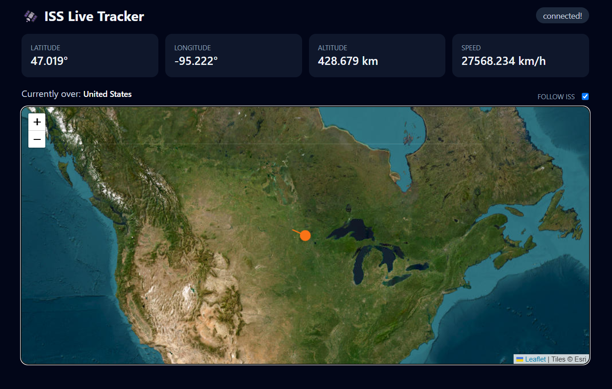

# 🛰️ ISS Live Tracker

A real-time dashboard that tracks the International Space Station as it orbits the Earth, showing its live position, altitude, and speed on an interactive satellite map, plus the country it is flying over.



[](https://g0dwarri0r.github.io/iss-tracker/)

## Features

- Live latitude, longitude, altitude, and speed, refreshed every few seconds
- Interactive satellite map with a marker and a trail showing the ISS path
- "Follow ISS" toggle to keep the map centered on the station
- "Currently over" label showing the country, or open ocean
- Connection status indicator that recovers automatically after a failed request

## APIs and Services

| Service | Used for |
|---|---|
| [Where the ISS at? API](https://wheretheiss.at/w/developer) | Live ISS position and speed, and the country lookup for given coordinates |
| [Leaflet](https://leafletjs.com/) | Interactive map, marker, and trail |
| [Esri World Imagery](https://www.arcgis.com/home/item.html?id=10df2279f9684e4a9f6a7f08febac2a9) | Satellite map tiles |
| [Tailwind CSS](https://tailwindcss.com/) | Styling |

No API keys are required.

## Key JavaScript Concepts

- **`fetch` with `async/await`**: requesting data from the APIs and writing asynchronous code that reads top to bottom
- **`try/catch` with `throw`**: checking `response.ok` and handling failed requests without crashing the app
- **Polling loop with a custom `sleep()`**: a `while (true)` loop that awaits a Promise wrapped around `setTimeout`, so each update finishes before the next starts
- **DOM manipulation**: `querySelector` and `textContent` to update the readouts live
- **`Intl.DisplayNames`**: a built-in browser API that converts country codes like `IN` into names like `India`
- **Leaflet methods**: `setLatLng`, `addLatLng`, and `panTo` to move the marker, grow the trail, and follow the ISS

## Run Locally

```bash
git clone https://github.com/G0dWarri0r/iss-tracker.git
```

Open `index.html` in a browser, or serve it with the Live Server extension in VS Code.